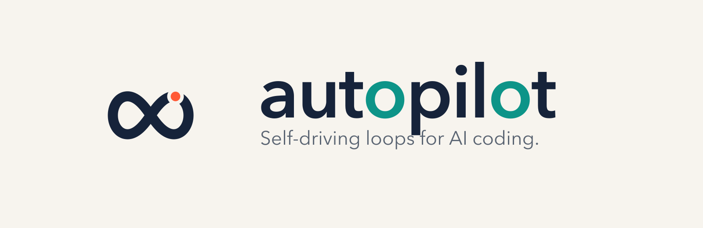

<div align="center">
  <picture>
    <source media="(prefers-color-scheme: dark)" srcset="assets/brand/banner-dark.svg" />
    
  </picture>

  <p><strong>给 AI 编码装上自动驾驶仪的状态机 loop engine。</strong><br/>
  从目标到合并全程无人值守——但你始终坐在机长席上，而不是驾驶舱里。</p>

  <p>
    <a href="https://github.com/strzhao/autopilot/stargazers"></a>
    <a href="LICENSE"></a>
    
  </p>

  [English](README.md) | **简体中文**
</div>

---

<div align="center">
  
  <br/>
  <sub><strong>一次真实的无人值守运行（回放，提速）：</strong>一句目标进来——设计、红蓝实现、证据闸门 QA、合并提交出去。途中它自行发现基线测试脚本坏了、隔离根因、绕行并在最终报告里如实披露。</sub>
</div>

## autopilot 是什么

当你输入 `/autopilot 实现用户头像上传功能`，它**不会**直接开始写代码。

它先深入分析你的代码库——架构、技术栈、已有模式、可复用的工具函数——产出设计文档交给你审批。审批通过后，红蓝两个独立 Agent 同时开工：**蓝队**只拿实现计划写代码，**红队**只拿设计文档写验收测试，互相看不见对方。编码完成进入五层 QA，不放行任何没有证据的「完成」。全部通过后你做最终验收，autopilot 智能提交并合并，顺手把设计决策和调试教训沉淀进项目知识库。

驱动这一切的，是一台**状态机 loop engine**：每轮结束，Stop hook（1279 行状态机）读取状态文件，机械地决定「阻塞重注入下一阶段指令」还是「放行」。相比「同一份 prompt 反复跑到 TODO 清空」的哑循环（Ralph loop），autopilot 的每一圈都知道自己在哪个阶段、该注入什么、哪个闸门没过、缺什么证据——**哑循环是定速巡航，autopilot 是带飞行管理系统的真自动驾驶**。

默认全程你只介入两次：**批准飞行计划（设计审批）和决定降落（最终验收）**。中间的一切 loop 自己飞——而当每个闸门都有证据放行时，闸门本身也可以委托出去（项目模式 `auto_approve`，或 CI 场景的 `--headless` 档位，交互点全部确定性化、留痕可 grep）。

## 航空运营系统 → AI 编码

民航是最安全的交通方式——不是因为飞行员更聪明，而是因为那套运营体系。autopilot 把它搬给了 AI 编码：

| 航空 | autopilot |
|---|---|
| 自动驾驶仪持续巡航 | Stop hook loop engine（每轮阻塞/重注入/放行的状态机） |
| 飞行计划与航路点 | 6 阶段状态机 + 两道人工门 |
| 双人机组交叉核对 | 红蓝对抗编码 |
| 签派放行标准 | 谓词闸门：**∀ 谓词 PASS ∧ 0 Critical** |
| 黑匣子 + 航后讲评 | 知识工程：决策与教训自动沉淀 |
| 航前检查单 | `doctor`：14 维工程适航认证 |
| 机长接管点 | 设计与验收两道人工门——可亲自把守，也可在证据全绿时委托自动放行 |

## Loop 上的四层系统

**1 · 阶段编排。** fast/standard 按任务自适应（在代码库探针之后判定，不盲猜）。项目模式把多个任务编排成 DAG，任务间只通过 ≤500 字 handoff 传递上下文，不共享会话状态。auto-chain 基于证据而非计数：走过 auto-fix 又全绿收敛的任务，不会中断链式执行。

**2 · 对抗生产。** 红队只根据设计文档写验收测试，蓝队只根据实现计划写代码。隔离靠机械强制而非口头约定：节级读取白名单、路径传递取代内容内联、红队测试物理暂存区、sha256 篡改锁——「绝不改红队测试」是一条确定性 hook，不是一句劝告。

**3 · 证据验收。** 三波五层：并行命令（红队测试/类型/Lint/单测/构建）→ 真实场景冒烟（真 curl API、真点页面）→ 独立 AI 审查。合并闸门是一个公式而不是一种感觉：**∀ 谓词 PASS ∧ 0 Critical**。没有 artifact 的 PASS 会被机械判为 FAIL。检测到变异/覆盖率工具时门槛为 mutation ≥60%、coverage 80/70——Meta 的 ACH 系统（FSE 2025，论文 [*Mutation-Guided LLM-based Test Generation at Meta*](https://arxiv.org/abs/2501.11847)）实测：同一批类上，变异导向生成的测试杀死 12–15% 变异体，覆盖率导向只有 2.0–2.4%。

**4 · 知识工程。** 每次 merge 自动提取决策与教训写入零冲突 inbox（写侧一任务一文件，merge 冲突按构造消失），design 阶段两跳检索消费，配防过拟合 5 问自检与 180 天时效核对。你的下一个任务，从更聪明开始。

## 技能清单

| 技能 | 干什么 |
|---|---|
| `/autopilot <目标>` | 完整闭环：目标 → 合并 |
| `/autopilot commit` | 上下文感知智能提交——已过 QA 的代码自动跳过再优化；测验考设计权衡而非语法 |
| `/autopilot doctor` | 14 维适航评分（S–F 六级）+ 兼容性矩阵：精确告诉你 autopilot 哪些功能在你项目会降级、为什么 |
| `/autopilot next`（项目模式） | 从 DAG 取下一个就绪任务，每个任务都是一次完整 loop |
| brainstorm（design 阶段内置） | 一次一问的需求探索；知识库已回答过的问题绝不重问 |

## 数字

**146 个版本** / 6.5 个月（峰值一天 8 版）· **33,583 行**可执行 shell/Node 代码 · **90+ 个验收套件**、约 500 条断言 · `doctor` 输出 **15 行**功能×维度兼容性矩阵 · **每一个**防御机制都能追溯到一次真实事故。

## 快速开始

### Claude Code

```bash
/plugin marketplace add https://github.com/strzhao/autopilot.git
```

然后在市场里安装 **autopilot**。手动方式：clone 本仓库后执行 `/install plugins/autopilot`。

### Codex CLI

```bash
git clone https://github.com/strzhao/autopilot.git && cd autopilot && codex
```

进入 Codex 后输入 `/plugins` → **String Codex Plugins** → 安装 **Autopilot for Codex**。

## 用自己开发自己

autopilot 是用 autopilot 开发的——v3.68/v3.69 的发布就是系统给自己的作业打分。379 个 commit，84% 与 Claude 结对。一个人类，一支 AI 舰队，和一只记住这一切的黑匣子。

## 生态插件

| 插件 | 一句话描述 |
|------|-----------|
| [writer-skill](plugins/writer-skill/) | 博客向 / 技术文档向 / 专业技术博客向 / 阮一峰风格写作技能 + 文章评价 |
| [npm-toolkit](plugins/npm-toolkit/) | OIDC 自动发布（无需 token）+ GitHub Actions CI/CD 配置 |
| [summarizer](plugins/summarizer/) | 文章/视频/音频自动提取 + 结构化摘要 + flomo 保存 |
| [task-notifier](plugins/task-notifier/) | 任务执行完自动播放系统提示音 |

## Worktree 自动初始化

autopilot 通过 `WorktreeCreate` hook 在 worktree 创建时自动配置环境（symlink、确定性端口分配、依赖安装）。Claude Code 当前版本（≤ 2.1.128）有一个已知 gap（[issue #36205](https://github.com/anthropics/claude-code/issues/36205)）：`claude -w` 触发的 `WorktreeCreate` hook 不派发给 plugin 的 hooks.json。为此 plugin 同时注册了 `SessionStart` hook 兜底：每次 session 启动时检测未配置的 worktree 并自动 repair。

## 许可证与联系

MIT © String Zhao（[stringzhao@foxmail.com](mailto:stringzhao@foxmail.com)）· 仓库：<https://github.com/strzhao/autopilot>
